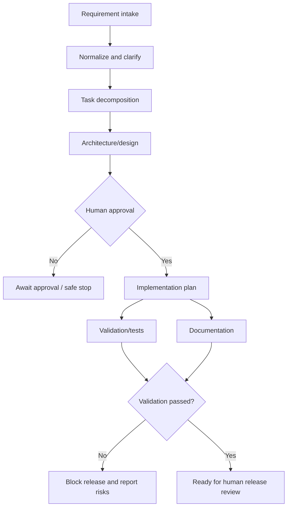

# Architecture and Control Flow

## Goal
Convert an engineering requirement into a reviewable outcome with bounded autonomy. Agents may prepare plans and artifacts; a human owns approval and release quality.

## Components
1. **HTTP API** — accepts URL creation, lookup, redirect, analytics, and orchestration requests.
2. **URL service/store** — validates absolute HTTP/HTTPS URLs, allocates random short codes, stores mappings, and records click events.
3. **Orchestrator** — tracks run ID, scenario, requirement, stage statuses, decisions, risks, elapsed time, and approval state.
4. **Validation branch** — checks that a requirement is sufficiently meaningful and relevant to the requested prototype.
5. **Documentation branch** — prepares a documentation artifact summary independently of validation.
6. **Human gate** — blocks implementation/release progression unless `approved=true` is explicitly provided.
7. **Release gate** — only marks a run ready for human review when validation passes; it does not deploy.

## Dependency graph

The test and documentation branches are independent and run concurrently after approval. Release readiness synchronizes their results. The current implementation records stage outcomes in the response; persistent storage and full event sourcing are production extensions.

## Governance
- **Least autonomy:** no deployment or external side effects.
- **Approval:** plan progression requires an explicit caller-provided approval flag.
- **Safe-stop:** ambiguous requirements return `needs_clarification`; validation failures block release.
- **Auditability:** every response includes a run ID, stage names/statuses, decisions, risks, and elapsed time.
- **Bounded work:** no unbounded agent loop; production retries must use an explicit maximum and backoff.
- **Policy guardrails:** only HTTP/HTTPS original URLs are accepted; expiry must be in the future.

## Reliability metrics to add in production
- Run success rate = successful runs / total runs.
- Retry frequency = retry attempts / total stage executions.
- Rollback frequency = rolled-back changes / changes applied.
- End-to-end latency = run completion timestamp - run start timestamp.
- MTTR = time from incident start to service restoration.

This prototype reports end-to-end duration but does not claim real MTTR or rollback metrics because it does not operate a production deployment system.
